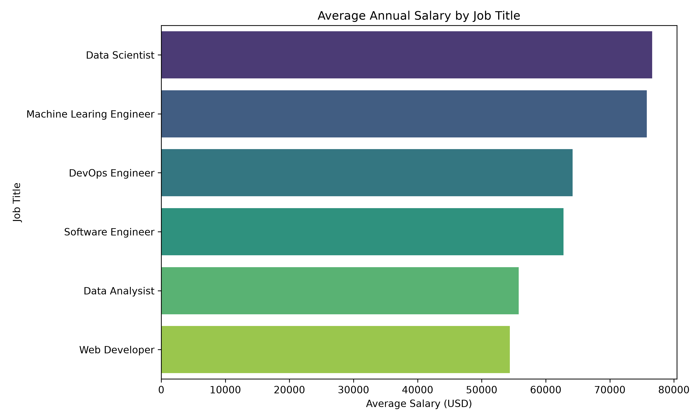
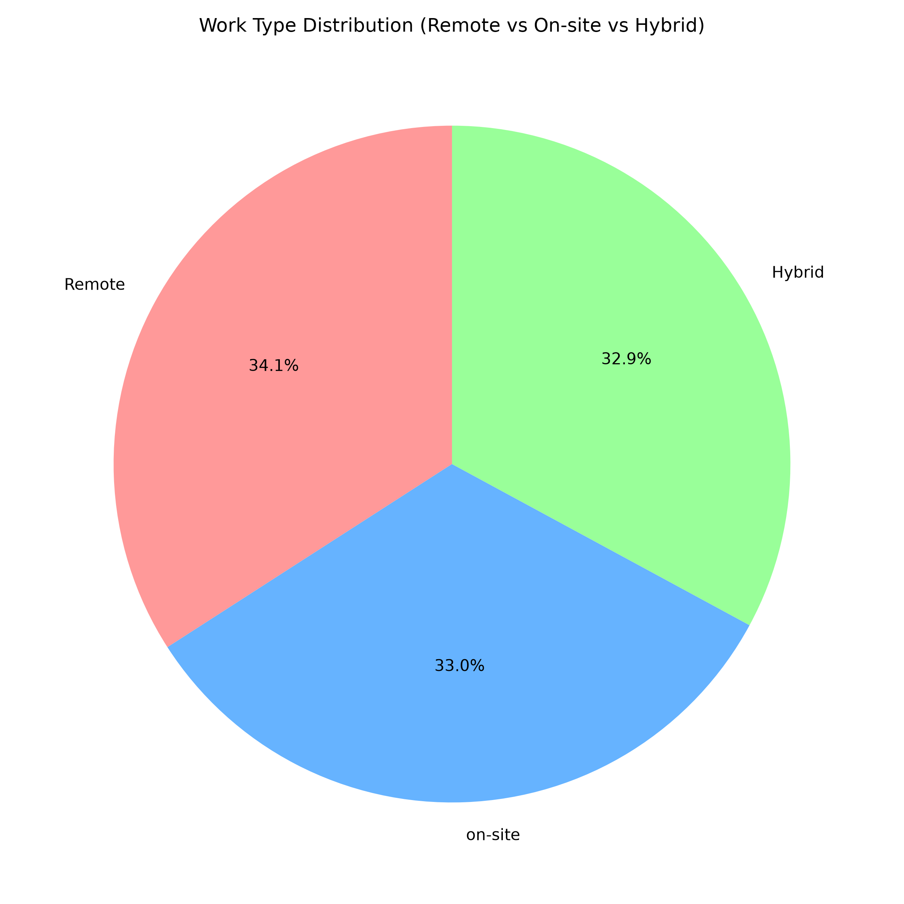

# Tech Salaries Data Analysis 📊

## Overview
This project involves generating a realistic synthetic dataset of 1,000 tech industry employees and performing data analysis to extract key insights regarding salaries, experience levels, and work types.

## Tools & Libraries Used
- **Python**
- **Pandas** (Data manipulation and analysis)
- **Matplotlib & Seaborn** (Data visualization)
- **NumPy & Random** (Data generation)

## Project Workflow
1. **Data Generation (`generate_data.py`):** Created a script to simulate realistic employee data, considering factors like job title, experience level, company size, and their impact on base salaries.
2. **Data Analysis & Visualization (`analyze_data.py`):** 
   - Loaded and cleaned the generated CSV dataset.
   - Calculated average annual salaries across different job titles.
   - Analyzed the distribution of work types (Remote, On-site, Hybrid).
   - Generated professional, presentation-ready charts to illustrate these findings.

## Key Insights & Visualizations

### 1. Average Annual Salary by Job Title
Data Scientists and Machine Learning Engineers consistently command the highest average salaries in this dataset.

### 2. Work Type Distribution
A breakdown of how the workforce is distributed across remote, on-site, and hybrid work models.

## How to Run the Project
1. Clone the repository to your local machine.
2. Ensure you have the required libraries installed: `pip install pandas matplotlib seaborn numpy`.
3. Run `generate_data.py` to create a fresh `tech_salaries.csv` dataset.
4. Run `analyze_data.py` to perform the analysis and generate the visualization images.
